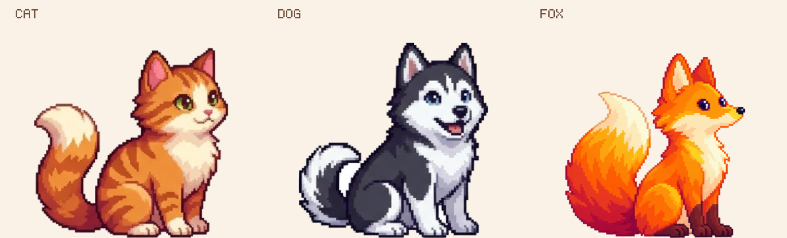

# Lil Buddy

A quiet desktop pet for macOS and Windows. Choose an orange tabby cat, a husky,
a detailed golden-orange fox, or a black crow. Cat, Dog, and Fox use bundled
character artwork directly so their faces, fur, and proportions remain detailed
through animation. No AI service, account, or internet connection is needed at runtime.

Free to download, use, modify, and share. Original project source and artwork
use the [MIT License](LICENSE). Packaged applications combine Lil Buddy with
PyQt6 and are distributed under GPL version 3; see [Licensing](#licensing).



## Download and install

**[Download for Windows (64-bit)](https://github.com/A-Erkhembileg/lil-buddy/releases/latest/download/Lil-Buddy-Windows-amd64.zip)**
· **[Download for Mac (Apple silicon)](https://github.com/A-Erkhembileg/lil-buddy/releases/latest/download/Lil-Buddy-macOS-arm64.dmg)**
· **[Download for Mac (Intel)](https://github.com/A-Erkhembileg/lil-buddy/releases/latest/download/Lil-Buddy-macOS-x86_64.dmg)**

Downloads are public and do not require a GitHub account or Python. Find all
packages and the source ZIP at [GitHub Releases](https://github.com/A-Erkhembileg/lil-buddy/releases/latest).

**Cloning, `git pull`, and Code → Download ZIP download the Python source.**
They do not include a Windows executable. To run the app without Python, use
the Windows download above.

- **macOS:** download the DMG for your Mac's processor, open it, and drag
  **Lil Buddy.app** to Applications. Open the app and use the menu-bar face for
  settings and quit. An `arm64` build is for Apple silicon; an `x86_64` build is
  for Intel.
- **Windows:** download **Lil-Buddy-Windows-amd64.zip**, right-click it and choose
  **Extract All**, then open **Lil Buddy.exe** in the extracted folder. The
  executable's name contains a space; Windows may display it as **Lil Buddy**
  when filename extensions are hidden. Use its system-tray icon for settings
  and quit.

These are unsigned preview builds: the Mac bundle is ad-hoc signed, without
Apple notarization, and the Windows executable has no publisher certificate.
Your operating system may show a security prompt. Source instructions below
are available if you prefer to run or build the app yourself.

## Controls

Left-click to pet your buddy. It responds for three seconds with happy eyes,
a nuzzle, a vibrating tail, floating hearts, and a species-specific quote.
Left-drag to pick it up; release to drop it. Fast movement stretches its body,
its ears flatten, and its paws paddle. Hard landings squash and rebound.

Right-click the pet, or use its menu-bar/tray icon:

- **Change Color:** Natural Coat, Charcoal Grey, Tuxedo Black, Calico Orange, or Custom RGB.
  RGB previews live; Cancel restores the previous choice.
- **Animal Type:** Cat, Dog, Fox, or Crow, each with its own animations and quotes.
  Natural Coat preserves the supplied tabby's orange stripes and green eyes,
  the husky's charcoal-and-white coat and blue eyes, and the fox's orange/gold
  fur, purple eyes, cream bib, and full curved tail. Walking plays whole-body drawings from each animal’s walk study.
  Each walk has 64 samples over roughly one second. Longer paw swings get
  more in-between frames, including across the loop boundary. Stride advances with distance travelled at every pet size.
  The resting, petting, sleeping and habit poses move at the head, chest, paws
  and tail. Blinking follows its own clock, so breathing continues through a
  blink. Picking up and releasing a pet keeps its airborne gesture in phase.
- **Take flight:** available for Crow. Eight wing phases accompany momentum,
  flap-driven lift, air drag, gentle steering, and a controlled descent. A crow
  can also take short spontaneous flights during idle habits. Releasing it
  above the floor starts a flight when roaming is enabled; disabling roaming
  during flight brings it down gently. Pausing and fullscreen mode still apply.
- **Pet Size:** Small, Medium, or Large. Drawing, hit testing, and physics resize
  together; feet remain on the floor.
- **Show Pet:** hide or restore the pet without quitting. Hiding is available
  when a tray/menu-bar icon is present, so the pet can always be brought back.
- **Pause:** freeze movement and animation while keeping the controls available.
- **Allow wandering:** enable autonomous walking and naps.
- **Idle habits:** quiet grooming, yawning, stretching, preening, and play bows.
- **Watch cursor:** occasional short attention poses; disabled by default. The
  pet never grabs, moves, or chases your pointer.
- **Back to floor / Quit Lil Buddy:** recover its position or exit.

Control-click also opens the pet menu on macOS. Ctrl-C exits when launched from
an interactive terminal. Double-clicking the Windows tray icon toggles visibility.

## Remembered preferences

Colors (including RGB), animal, size, roaming, pause, habit choices, display, and
last normal position are saved automatically. Temporary full-screen corner
positions never replace the normal saved position. The next launch is always
visible, even if the previous session was hidden.

Preferences live in `Lil Buddy/preferences.ini` under the operating system's
standard configuration directory. Set `LIL_BUDDY_SETTINGS_DIR` to choose another
location. Automated checks use temporary settings and do not alter your choices.

## Full-screen behavior

A separate 250 ms monitor checks foreground-window geometry on the pet's display.
A full-display window activates corner mode; ordinary maximized work-area windows
do not. Borderless windows covering the whole display count as fullscreen.

The pet cancels speech and dragging, stops its animation/physics timer, and snaps
to the exact top-right edge as a small static, input-transparent face. Two
consecutive non-fullscreen observations (about half a second) release it into
gravity. Pause and hide preferences remain in effect. Its menu-bar/tray controls
stay available throughout.

Detection reads window geometry and process identifiers, without screenshots,
window titles, Accessibility access, or Screen Recording requests. The operating
system can still place secure/exclusive fullscreen surfaces above the pet.
On Windows, the pet's native window identifies its monitor independently of
friendly display names; geometry comparisons use native pixels for mixed-scale
displays. Version 1.0.1 fixes corner mode failing to start on these monitors.

**Known macOS issue:** petting the animal may switch desktops when another app
uses a fullscreen Space. This remains unresolved in the current preview.

## Run from source

Requires Python 3.10+, Git, and a graphical macOS or Windows desktop.
Clone the project first, or use GitHub's **Code → Download ZIP** and extract it:

```sh
git clone https://github.com/A-Erkhembileg/lil-buddy.git
cd lil-buddy
```

On macOS:

```sh
python3 -m venv .venv
./.venv/bin/python -m pip install -r requirements.txt
./.venv/bin/python desktop_cat.py
```

On Windows, in PowerShell:

```powershell
py -3 -m venv .venv
.\.venv\Scripts\python.exe -m pip install -r requirements.txt
.\.venv\Scripts\python.exe desktop_cat.py
```

Skip virtual-environment creation if `.venv` exists. Cocoa is installed only on
macOS. The runtime remains consolidated in `desktop_cat.py`; keep the `artwork/`
folder beside it when running from source. Native app downloads already bundle
all required artwork. `tools/` and `packaging/` contain build tooling and app icons.

## Sprite sheets and flight preview

`artwork/animal-sprite-sheet.png` shows all four animals on a solid background.
The crow row contains its perch and all eight flight phases; the other rows
show their supplied character poses and walking cycles.
`artwork/crow-flight.gif` previews the complete wing cycle.

Each detailed animal has its own transparent 400 by 320 frame atlas and JSON clip
definitions. Crow retains its 60 by 48 pixel grid. `animal-sprites-atlas.json`
indexes all four exported animal atlases. The registered runtime assets live in
`artwork/motion/`; the new authored pose sheets and generation prompts are in
`artwork/motion-sources/`. The redrawn walks live in `artwork/walk-studies/`.
The live renderer articulates limbs from one intact approved standing drawing.
Stride phase follows distance travelled; supporting soles stay on the fixed floor.
Pickup settles around a shoulder support, falling prepares the paws for contact,
and landing locks out decisions until compression, recovery and sitting finish.
Posture changes use separately registered key-pose clips in `*-transitions.png`;
the original drawings and walk studies remain available to the artwork tools. The desktop timer runs every 16 ms;
compact GIF previews are sampled at 25 fps. Preview motion in
[cat-animations.gif](artwork/cat-animations.gif),
[dog-animations.gif](artwork/dog-animations.gif), and
[fox-animations.gif](artwork/fox-animations.gif).

[Watch the full 60 fps motion preview](artwork/fluid-motion-60fps.mp4).
[Watch the walking and foot-contact check](artwork/walk-contact-60fps.mp4).

The [fox character model](artwork/fox-character-model.png) was created with image
generation from the supplied visual reference. Its original pixels and detailed
pose sheets are the runtime artwork, alongside the supplied Cat and Dog sheets.
The [generation prompt](artwork/fox-character-model-prompt.md) is included.
Previews and atlases are exports of the actual app renderer. Bake the registered
runtime atlases from the authored sheets, then regenerate the previews with:

```sh
./.venv/bin/python -B tools/bake_motion_atlases.py
# Only the offline walk importer needs these packages.
./.venv/bin/python -m pip install numpy opencv-python-headless
for animal in cat dog fox; do
    ./.venv/bin/python -B tools/import_walk_study.py --animal "$animal" \
        --sheet "artwork/walk-studies/$animal-walk.png" --subdivisions 4
done
./.venv/bin/python -B tools/export_sprite_sheet.py
```

The optional `tools/render_motion_video.py` exports a 60 fps MP4 using FFmpeg
(`--ffmpeg /path/to/ffmpeg`, or an installed `imageio-ffmpeg`). This encoder is
only for creating previews; the app does not include or require it.

The updated comparison uses the original motion showcase as its unchanged
before panel. Chapter cuts are intentional; the runtime audit contains continuous
mouse interruptions, floor-marked walks, turns, queued reactions and sleep:

- [Before / after at 60 fps](artwork/lil-buddy-motion-before-after.mp4)
- [Quarter-speed comparison](artwork/lil-buddy-motion-before-after-slow.mp4)
- [Continuous app behavior audit](artwork/lil-buddy-motion-runtime-audit.mp4)

Reproduce the updated exports with:

```sh
# Rebuild posture clips only when source art or registration landmarks change.
# This offline tool needs numpy and opencv-python-headless; playback does not.
./.venv/bin/python tools/bake_action_transitions.py
./.venv/bin/python tools/render_motion_comparison.py --ffmpeg /path/to/ffmpeg
```

Remaining limits: posture clips interpolate a small set of original 2D drawings;
texture and silhouette changes can still be noticeable at quarter speed. Turns
use a brief end-on projection rather than a newly illustrated front view. Crow
wingbeats retain eight crisp pixel poses. Torso and facial proportions stay
rigid during the articulated ground and airborne actions; fine ear articulation
is conservative to retain the approved illustration.

## Build native apps

```sh
./.venv/bin/python -m pip install -r requirements-build.txt
./.venv/bin/python tools/build_app.py --dmg
```

On Windows, use `.\.venv\Scripts\python.exe tools\build_app.py` without `--dmg`.
The build uses PyInstaller on the target operating system. Mac output contains
`dist/Lil Buddy.app`, an architecture-specific ZIP, and optionally a DMG. Windows
output contains `dist/Lil Buddy.exe` and a ZIP with instructions. Packages include
the application source, third-party notices, and dependency license texts.

The **Build apps** workflow builds macOS Apple silicon, macOS Intel, and Windows
x64 packages on native GitHub runners. It runs the test suite and launches every
frozen executable in isolated smoke mode before publishing. Branch builds
provide temporary Actions artifacts. A successful main build publishes a new
public GitHub Release when the version in `tools/build_app.py` has no existing
release; version tags such as `v1.0.0` can also trigger publication. Existing
releases are left unchanged, so increment `APP_VERSION` for the next release.

Releases include DMGs, application ZIPs, the matching source ZIP, and
`SHA256SUMS` checksums. Anyone can download them without signing in.

## Verify

```sh
./.venv/bin/python -B -m unittest discover -s tests -v
./.venv/bin/python desktop_cat.py --smoke-test --smoke-test-report build/source-smoke.json
```

Unit checks cover physics, animations, animals, palettes, preferences, sizes,
controls, habits, and fullscreen transitions. The packaged smoke test checks real
startup, all animals and sizes, speech, pause/hide, and latch/release in temporary
settings. The Windows runner also checks fullscreen and ordinary window geometry
against real Win32 windows, then verifies the executable builds and starts. Manual
checks of exclusive games and different display layouts remain useful on actual
user machines.

## Project layout

```text
desktop_cat.py               Complete pet engine and embedded pixel art
requirements.txt             Runtime dependencies
requirements-build.txt       Packaging and sprite-export dependencies
artwork/                     Sprite sheet, atlas, and crow flight preview
packaging/icons/             Application icons
tools/                       Native app builder and sprite exporter
tests/                       Automated checks
.github/workflows/           macOS/Windows builds and tagged releases
LICENSE                      MIT license for original source and artwork
THIRD_PARTY_NOTICES.md        Bundled dependency notices
licenses/                    Dependency license texts
```

There is one project folder and one application entry point. `.venv/` is a local
Python environment, `build/` contains generated working files, and `dist/`
contains local installers. These generated folders, caches, and personal
settings are excluded from Git. They are not needed in a source download.

To update a clone, run `git pull` from the project folder, then reinstall the
requirements if they changed. Quit and reopen the pet to load updated code.
To update a packaged app, quit it and download the latest package from Releases;
`git pull` does not update a previously downloaded executable.

## Licensing

Original Lil Buddy source code and artwork are provided under the
[MIT License](LICENSE). The packaged applications include PyQt6, so the combined
executables are distributed under GPL version 3. This does not require a fee to
use, download, or share the app; redistribution must preserve the applicable
license terms and source availability.

Packages include the application source, [third-party notices](THIRD_PARTY_NOTICES.md),
and [dependency license texts](licenses/). Each GitHub Release includes a source
ZIP matching that exact release. See the notices for the licenses and source
locations of bundled dependencies.

## Contributing

Bug reports and pull requests are welcome at
[the GitHub repository](https://github.com/A-Erkhembileg/lil-buddy).
Include your operating system, processor architecture, and steps to reproduce a
problem. Run the checks above before submitting code changes. Keep animal art
and runtime behavior in `desktop_cat.py` so source launches stay self-contained.
